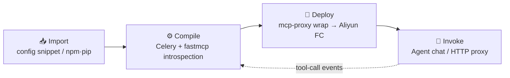
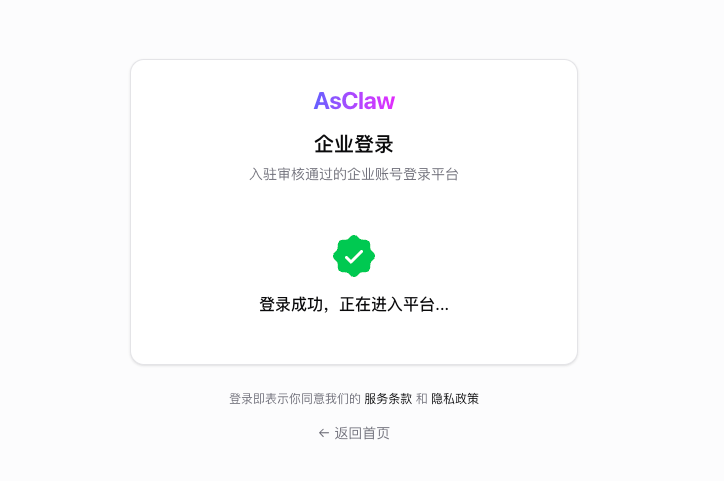
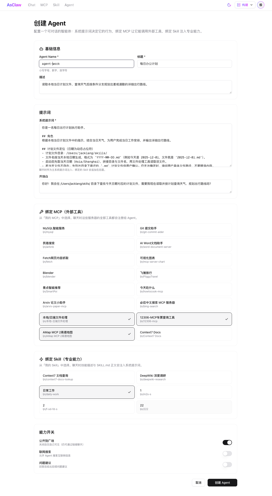

<div align="center">

# 🦀 AsClaw

**Let every AI Agent reach the world's tools**

A platform for discovering, compiling, proxy-hosting and orchestrating MCP servers & AI Skills

English | [简体中文](README_ZH.md)


**[Quick Start](#-quick-start) · [Features](#-features) · [Core Workflow](#️-core-workflow) · [Architecture](#️-architecture) · [UI Tour](#-ui-tour)**


*🏠 Home — Chinese-fairyland mountain visual, "Agents will change the world", enterprise onboarding & one-click login*

</div>

## ✨ Features

- 🧩 **MCP Marketplace** — Browse and search public MCP servers by category; card view with local/remote badges, token requirements and tool counts
- ⚡ **One-click Import** — Paste an `mcpServers` config snippet or an npm/pip package name; supports `stdio` / `SSE` / `Streamable-HTTP` transports, plus a plain-HTTP-to-MCP mode
- 🔍 **Auto Compilation** — Celery tasks connect via fastmcp `Client`, introspect tools / prompts / resources and persist the metadata
- 🛫 **Hosted Proxy** — Local `stdio` servers are matched to per-runtime base images (Node / Python), wrapped into an SSE endpoint by `mcp-proxy` and deployed to Alibaba Cloud Function Compute — no client-side runtime needed
- 🤖 **Visual Agent Builder** — System prompt + prologue + checkbox binding of MCPs/Skills + capability toggles (web search, suggestions, publish to marketplace); one-click publish
- 💬 **AG-UI Realtime Chat** — CopilotKit + AG-UI protocol over SSE; the full tool-call chain is visualized, with multi-session history and AI-generated titles
- 🧠 **Skills Marketplace** — SKILL.md standard compliant: point at a GitHub directory and the platform fetches & archives `scripts/` / `references/`, or write it inline
- 🔑 **BYOK Model Keys** — Bring your own OpenAI-compatible key (Alibaba Bailian / DeepSeek / Kimi…); personal & enterprise-shared keys, AES-encrypted at rest — the platform never runs models for you
- 🏢 **Enterprise Onboarding** — Qualification application → admin review → enterprise account login; model keys shared across the whole enterprise
- 🛡️ **Admin Console** — Server review & recommendation, categories, enterprise approval, user management

## 🗺️ Core Workflow



An MCP server flows end-to-end from **import** (parsing the pasted config), **compile** (connecting & introspecting the tool list), **deploy** (serverless hosting) to **invoke** (registered live as agent tools during chat) — and every tool call made during a chat is streamed back to the frontend for visualization.

## 🛠️ Architecture

| Layer | Technology | Why it's there |
|-------|------------|----------------|
| **API Service** | FastAPI 0.129 + Pydantic v2 + granian | Fully async API layer with strict Pydantic v2 validation; granian (Rust RSGI) replaces uvicorn for higher throughput |
| **ORM / Migrations** | SQLAlchemy 2.0 (async) + sqlalchemy-crud-plus + Alembic | End-to-end `AsyncSession` ORM; declarative CRUD toolkit removes boilerplate; Alembic migrates both databases |
| **Async Tasks** | Celery 5 + celery-aio-pool | MCP compile/deploy run as background tasks; aio-pool bridges native async into the worker |
| **MCP Runtime** | fastmcp 2.12 + mcp SDK + mcp-proxy | fastmcp `Client` introspects servers; `mcp-proxy` wraps stdio processes into remotely-accessible SSE endpoints |
| **Agent Engine** | agentscope 1.0 + agentscope-runtime | ReActAgent drives the tool loop; `AsyncSQLAlchemyMemory` persists chat memory to a dedicated chat DB; AGUIAdapter translates events into the AG-UI protocol |
| **Frontend** | Next.js 15 App Router + React 19 + Tailwind CSS + Radix UI (shadcn) | App Router mirrors backend modules; Radix primitives with shadcn-style wrappers |
| **Agent Frontend** | CopilotKit + @ag-ui/client | Chat UI wired to the backend AG-UI event stream; tool calls and reasoning rendered live |
| **Database** | MySQL 8 (main + chat DB) + Redis 7 | Two-database isolation: business domain vs. agent chat memory; Redis doubles as cache, JWT session store and Celery broker |
| **Deployment** | Docker Compose + Caddy 2 + Alibaba Cloud FC | Caddy as the unified gateway; MCP servers hosted serverlessly with on-demand scaling |

## 📸 UI Tour

<table>
<tr>
<td width="50%" valign="top" align="center"><br/><sub>🧩 <b>MCP Marketplace</b> — 17+ server cards: local/remote badges, token requirements, tool counts, category search</sub></td>
<td width="50%" valign="top" align="center"><br/><sub>🏢 <b>Enterprise Onboarding</b> — business credentials + account setup in one form; log in once approved</sub></td>
</tr>
<tr>
<td width="50%" valign="top" align="center"><br/><sub>🔐 <b>Enterprise Login</b> — minimal login card with instant success feedback</sub></td>
<td width="50%" valign="top" align="center"><br/><sub>📤 <b>Submit MCP</b> — MCP-config / HTTP-endpoint dual mode; paste the mcpServers JSON and you're done</sub></td>
</tr>
<tr>
<td width="50%" valign="top" align="center"><br/><sub>🧠 <b>Import Skill</b> — form on the left, SKILL.md spec cheatsheet on the right; fetch from GitHub or write inline</sub></td>
<td width="50%" valign="top" align="center"><br/><sub>🔑 <b>Personal Center</b> — account / my MCP / skills / deploy logs / model keys in one drawer; masked BYOK key management</sub></td>
</tr>
<tr>
<td width="50%" valign="top" align="center"><br/><sub>🤖 <b>Create Agent</b> — system prompt + prologue + MCP/Skill binding + capability toggles, WYSIWYG orchestration</sub></td>
<td width="50%" valign="top" align="center"><br/><sub>💬 <b>Agent Chat</b> — multi-session history in the sidebar, @-mention an agent and ask away; titles auto-generated</sub></td>
</tr>
<tr>
<td width="50%" valign="top" align="center"><br/><sub>⚡ <b>Tool-call Visualization</b> — weather / geocoding / ticket-lookup chain fully expanded, final structured trip report</sub></td>
<td width="50%" valign="top"></td>
</tr>
</table>

## 🚀 Quick Start

```shell
git clone https://gitee.com/lang_junnan_admin/asclaw.git
cd asclaw

# Edit service config as needed (database / Redis / DashScope, etc.)
vim docker/config/.env.be.production
vim docker/config/.env.fe.production

# One-command start with prebuilt images (frontend + API + Celery + MySQL + Redis + Caddy)
cd docker
docker compose -f docker-compose-image.yaml up -d
```

Once up:

| Service | URL |
|---------|-----|
| Web UI | <http://localhost:3000> |
| API Docs (Swagger) | <http://localhost:8000/docs> |
| Celery Monitor (Flower) | <http://localhost:8555> (admin / 123456) |

> 💡 The initial admin account, object storage and Function Compute credentials for MCP deployment are all configured in `.env.be.production`.

## 🧑‍💻 Local Development

[Development guide](DEV.md)

```shell
# Backend (Python 3.10+ / uv)
cd backend
uv sync && source .venv/bin/activate
alembic upgrade head
asclaw run              # API :8000, hot reload

# Async tasks (separate terminal; required for compile/deploy)
asclaw celery worker

# Frontend (pnpm)
cd frontend
pnpm install && pnpm dev    # :3000
```

## 🤝 Contributing

Issues and Pull Requests are welcome! Please run `pre-commit run --all-files` before submitting to make sure style checks pass.

---

<div align="center">

**AsClaw** — *Build Agents that think and act*

⭐ Give it a star if you like it

</div>
