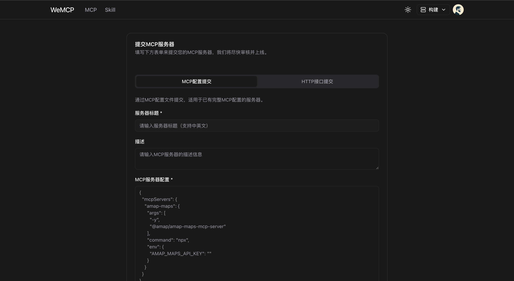
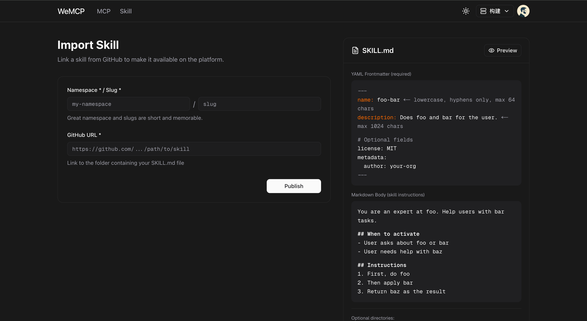
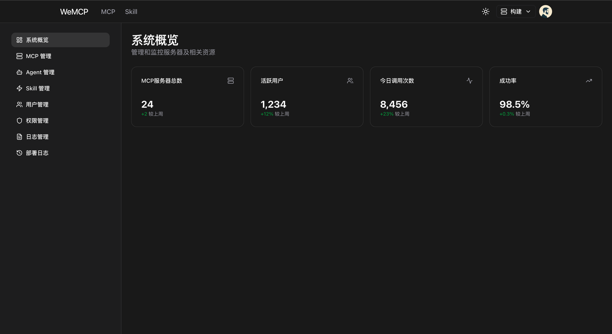

# ASCLaw

[英文](README.md) [中文](README_ZH.md)

ASCLaw 是一个 **MCP 与 Skills 集成平台** — 实时发现、发布和调试 MCP 服务器与 AI 技能。通过托管代理层将它们连接到你的 AI Agent，全部在统一的 Web UI 中完成。






## Features

- **MCP & Skills Marketplace** — Browse and search public MCP servers and AI skills by category
- **Real-time Debugging** — Test and debug MCP tools and skills directly in the browser with live feedback
- **One-click Import** — Add any `stdio` / `SSE` / `Streamable-HTTP` server from a config snippet or npm/pip package
- **Auto Compilation** — Automatically connects to the server, introspects tools / prompts / resources, and persists the
  metadata
- **Hosted Proxy** — Wraps local `stdio` servers into a remotely-accessible HTTP endpoint (no client-side runtime
  required)
- **Agent Chat** — Built-in chat interface backed by CopilotKit + AG-UI; interact with your servers directly in the
  browser
- **Email Login** — Email verification code login; servers can be public or private
- **Admin Panel** — Review, approve, and recommend servers; manage users and categories
- **i18n** — Chinese / English interface

## Tech Stack

| Layer         | Technology                                            |
|---------------|-------------------------------------------------------|
| Frontend      | Next.js 15, React, Tailwind CSS, Radix UI, CopilotKit |
| Backend       | Python 3.10+, FastAPI, Celery, SQLAlchemy 2, Alembic  |
| Database      | MySQL 8 (PostgreSQL also supported)                   |
| Cache / Queue | Redis                                                 |
| Proxy         | Caddy 2                                               |
| MCP Runtime   | `fastmcp`, `mcp` SDK                                  |

## Prerequisites

| Requirement    | Minimum         |
|----------------|-----------------|
| CPU            | 4 virtual cores |
| RAM            | 8 GB            |
| Docker         | 19.03.9+        |
| Docker Compose | 1.25.1+         |

## Quick Start

```shell
git clone https://gitee.com/lang_junnan_admin/asclaw.git
cd asclaw

# Copy and edit the environment file
cp backend/deploy/.env.server.example backend/deploy/.env.server

# Start all services
cd docker
docker compose up -d
```

## Development

[Development](DEV.md)
