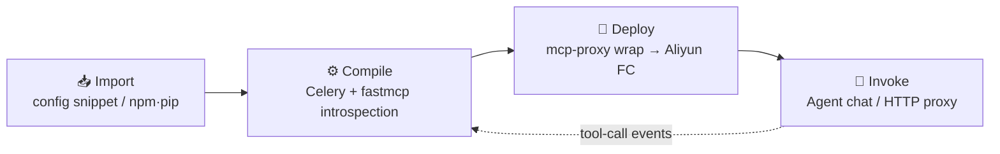
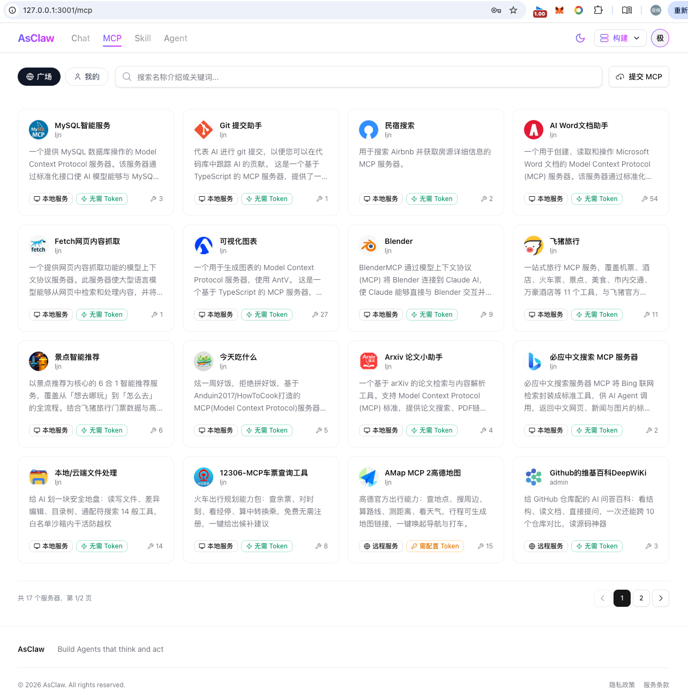
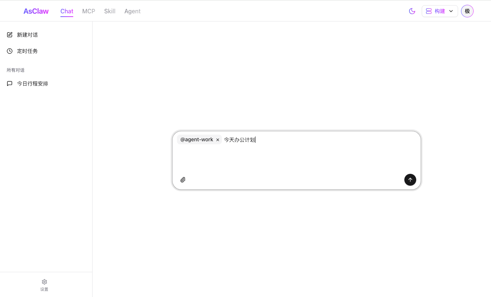
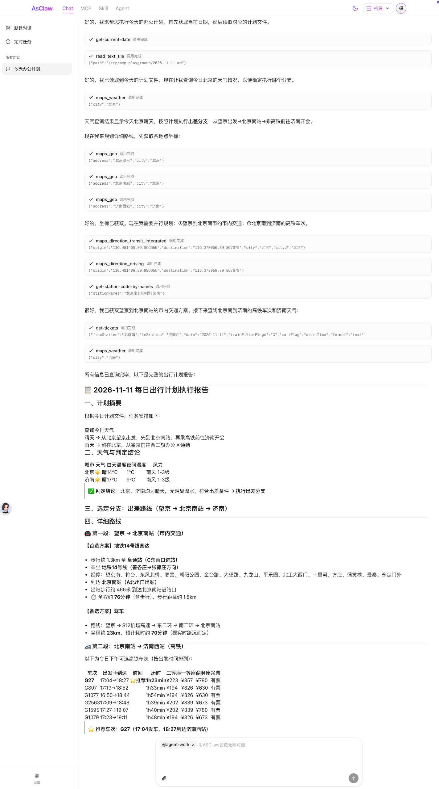

<div align="center">

# 🦀 AsClaw

**Let every AI Agent reach the world's tools**

A platform for discovering, compiling, proxy-hosting and orchestrating MCP servers & AI Skills

English | [简体中文](README_ZH.md)


**[Quick Start](#-quick-start) · [Features](#-features) · [Core Workflow](#️-core-workflow) · [Architecture](#️-architecture) · [UI Tour](#-ui-tour)**


*🏠 Home — Chinese-fairyland mountain visual, "Agents will change the world", enterprise onboarding & one-click login*

</div>

## ✨ Features

- 🧩 **MCP Marketplace** — Browse and search public MCP servers by category; card view with local/remote badges, token requirements and tool counts
- ⚡ **One-click Import** — Paste an `mcpServers` config snippet or an npm/pip package name; supports `stdio` / `SSE` / `Streamable-HTTP` transports, plus a plain-HTTP-to-MCP mode
- 🔍 **Auto Compilation** — Celery tasks connect via fastmcp `Client`, introspect tools / prompts / resources and persist the metadata
- 🛫 **Hosted Proxy** — Local `stdio` servers are matched to per-runtime base images (Node / Python), wrapped into an SSE endpoint by `mcp-proxy` and deployed to Alibaba Cloud Function Compute — no client-side runtime needed
- 🤖 **Visual Agent Builder** — System prompt + prologue + checkbox binding of MCPs/Skills + capability toggles (web search, suggestions, publish to marketplace); one-click publish
- 💬 **AG-UI Realtime Chat** — CopilotKit + AG-UI protocol over SSE; the full tool-call chain is visualized, with multi-session history and AI-generated titles
- 🧠 **Skills Marketplace** — SKILL.md standard compliant: point at a GitHub directory and the platform fetches & archives `scripts/` / `references/`, or write it inline
- 🔑 **BYOK Model Keys** — Bring your own OpenAI-compatible key (Alibaba Bailian / DeepSeek / Kimi…); personal & enterprise-shared keys, AES-encrypted at rest — the platform never runs models for you
- 🏢 **Enterprise Onboarding** — Qualification application → admin review → enterprise account login; model keys shared across the whole enterprise
- 🛡️ **Admin Console** — Server review & recommendation, categories, enterprise approval, user management

## 🗺️ Core Workflow



An MCP server flows end-to-end from **import** (parsing the pasted config), **compile** (connecting & introspecting the tool list), **deploy** (serverless hosting) to **invoke** (registered live as agent tools during chat) — and every tool call made during a chat is streamed back to the frontend for visualization.

## 🛠️ Architecture

| Layer | Technology | Why it's there |
|-------|------------|----------------|
| **API Service** | FastAPI 0.129 + Pydantic v2 + granian | Fully async API layer with strict Pydantic v2 validation; granian (Rust RSGI) replaces uvicorn for higher throughput |
| **ORM / Migrations** | SQLAlchemy 2.0 (async) + sqlalchemy-crud-plus + Alembic | End-to-end `AsyncSession` ORM; declarative CRUD toolkit removes boilerplate; Alembic migrates both databases |
| **Async Tasks** | Celery 5 + celery-aio-pool | MCP compile/deploy run as background tasks; aio-pool bridges native async into the worker |
| **MCP Runtime** | fastmcp 2.12 + mcp SDK + mcp-proxy | fastmcp `Client` introspects servers; `mcp-proxy` wraps stdio processes into remotely-accessible SSE endpoints |
| **Agent Engine** | agentscope 1.0 + agentscope-runtime | ReActAgent drives the tool loop; `AsyncSQLAlchemyMemory` persists chat memory to a dedicated chat DB; AGUIAdapter translates events into the AG-UI protocol |
| **Frontend** | Next.js 15 App Router + React 19 + Tailwind CSS + Radix UI (shadcn) | App Router mirrors backend modules; Radix primitives with shadcn-style wrappers |
| **Agent Frontend** | CopilotKit + @ag-ui/client | Chat UI wired to the backend AG-UI event stream; tool calls and reasoning rendered live |
| **Database** | MySQL 8 (main + chat DB) + Redis 7 | Two-database isolation: business domain vs. agent chat memory; Redis doubles as cache, JWT session store and Celery broker |
| **Deployment** | Docker Compose + Alibaba Cloud FC | MCP servers hosted serverlessly on Alibaba Cloud FC with on-demand scaling; MySQL/Redis provisioned via Docker Compose |

## 📸 UI Tour

<table>
<tr>
<td colspan="2" valign="top" align="center"><br/><sub>🧩 <b>MCP Marketplace</b> — 17+ server cards: local/remote badges, token requirements, tool counts, category search</sub></td>
</tr>
<tr>
<td width="50%" valign="top" align="center"><br/><sub>🏢 <b>Enterprise Onboarding</b> — business credentials + account setup in one form; log in once approved</sub></td>
<td width="50%" valign="top" align="center"><br/><sub>🔐 <b>Enterprise Login</b> — minimal login card with instant success feedback</sub></td>
</tr>
<tr>
<td width="50%" valign="top" align="center"><br/><sub>📤 <b>Submit MCP</b> — MCP-config / HTTP-endpoint dual mode; paste the mcpServers JSON and you're done</sub></td>
<td width="50%" valign="top" align="center"><br/><sub>🧠 <b>Import Skill</b> — form on the left, SKILL.md spec cheatsheet on the right; fetch from GitHub or write inline</sub></td>
</tr>
<tr>
<td width="50%" valign="top" align="center"><br/><sub>🔑 <b>Personal Center</b> — account / my MCP / skills / deploy logs / model keys in one drawer; masked BYOK key management</sub><br/><br/><br/><sub>💬 <b>Agent Chat</b> — multi-session history in the sidebar, @-mention an agent and ask away; titles auto-generated</sub></td>
<td width="50%" valign="top" align="center"><br/><sub>🤖 <b>Create Agent</b> — system prompt + prologue + MCP/Skill binding + capability toggles, WYSIWYG orchestration</sub></td>
</tr>
<tr>
<td colspan="2" valign="top" align="center"><br/><sub>⚡ <b>Tool-call Visualization</b> — weather / geocoding / ticket-lookup chain fully expanded, final structured trip report</sub></td>
</tr>

</table>

## 🚀 Quick Start

MySQL and Redis run as Docker containers; the API, Celery worker and frontend run
directly on your machine.

### Prerequisites

| Tool | Version | Used for |
|------|---------|----------|
| Docker + Docker Compose | — | MySQL & Redis (containers) |
| Python | 3.10+ | Backend |
| uv | latest | Backend deps & venv |
| Node.js | 20+ | Frontend |
| pnpm | 9+ | Frontend deps |

### 1. Start MySQL & Redis (containers)

```shell
git clone https://gitee.com/lang_junnan_admin/asclaw.git && cd asclaw
cd docker
docker compose -f docker-compose.dev.yml up -d
```

On the **first** boot (empty data volume) MySQL auto-runs
`docker/sql/mysql/init/*.sql` in filename order:

- `01_schema.sql` — creates the `asclaw` and `asclaw_chat` databases and **all tables**
  (idempotent; also stamps `alembic_version` at the current migration head)
- `02_data.sql` — seeds the admin `sys_menu` table, the default admin account and
  business data (17 MCP servers, 2 agents, 2 skills)

No manual SQL needed; these scripts don't re-run on later starts.

> ⚠️ **Heads-up**: the scripts only auto-run when the data volume is **empty**. If you redo
> the quick start by deleting just the containers/images, the old volume survives and MySQL
> **silently skips** the init scripts — leaving you with an empty database. To start truly
> from scratch, remove the volume too (this wipes all data in it):
>
> ```shell
> docker compose -f docker-compose.dev.yml down -v   # remove containers + volume
> docker compose -f docker-compose.dev.yml up -d     # empty volume → init scripts run
> ```
>
> Prefer to keep your data? Keep the volume and run the two scripts manually as shown in
> the "existing data volume" section below.

### 2. Backend

```shell
cd backend
uv sync && source .venv/bin/activate
cp .env.example .env      # adjust DATABASE_PASSWORD / DASHSCOPE_API_KEY as needed
asclaw run --port 8081    # API on :8081 (Swagger at /docs)
```

Database initialization is already done by step 1 (fresh volume). If you're reusing an
**existing** data volume (e.g. from an earlier quick start), run the two scripts once —
they're idempotent and never drop data:

```shell
docker exec -i mysql mysql -uroot -p'<DATABASE_PASSWORD>' --default-character-set=utf8mb4 \
  < docker/sql/mysql/init/01_schema.sql
docker exec -i mysql mysql -uroot -p'<DATABASE_PASSWORD>' --default-character-set=utf8mb4 \
  < docker/sql/mysql/init/02_data.sql
```

> Default admin account: **admin / admin** — change the password after your first login.

### 3. Celery worker + beat (separate terminals; required for MCP compile/deploy)

```shell
终端1
cd backend
source .venv/bin/activate
asclaw celery worker      # runs compile/deploy tasks
终端2
cd backend
source .venv/bin/activate
asclaw celery beat        # periodic: syncs deploy-log status every 30s
```

> They're plain foreground processes (no auto-restart in dev) — keep them running while
> you use compile/deploy; if one dies, re-run `./start.sh` (it skips whatever's already up).

### 4. Frontend

```shell
cd frontend
pnpm install
cp .env.example .env.local   # NEXT_PUBLIC_API_BASE_URL=http://localhost:8081
pnpm dev -p 3001            # :3001
```

Once up:

| Service | URL |
|---------|-----|
| Web UI | <http://localhost:3001> |
| API Docs (Swagger) | <http://localhost:8081/docs> |
| Celery Monitor (Flower) | <http://localhost:8555> (admin / 123456) |

### What runs automatically

- **Docker init SQL** — `docker/sql/mysql/init/01_schema.sql` + `02_data.sql` run on first
  MySQL boot (empty volume). `01_schema.sql` creates both databases and all tables;
  `02_data.sql` seeds menus, the admin account and sample data. Both are idempotent
  (`IF NOT EXISTS` / `INSERT IGNORE`).
- **Missing-table auto-create** — on startup the API creates any missing table
  (`create_tables`; create-only, never alters).

> Alembic is **not** part of the quick start anymore — `01_schema.sql` stamps
> `alembic_version` at the current head. Keep it for day-to-day incremental schema
> changes (`alembic revision --autogenerate` + `alembic upgrade head`).

### One-command launcher (optional)

Instead of steps 2–4, run the bundled launcher — it starts API + Celery worker/beat
+ Flower + frontend together (logs & pid files under `.run/`):

```shell
./start.sh    # API :8081 · Frontend :3001 · Flower :8555
./stop.sh
```

`./start.sh` uses the same ports as the manual steps above (so `frontend/.env.local`
should point at `http://localhost:8081`).

For migration authoring and pre-commit hooks, see [DEV.md](DEV.md).

## 🤝 Contributing

Issues and Pull Requests are welcome! Please run `pre-commit run --all-files` before submitting to make sure style checks pass.

---

<div align="center">

**AsClaw** — *Build Agents that think and act*

⭐ Give it a star if you like it

</div>
