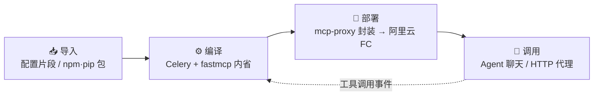
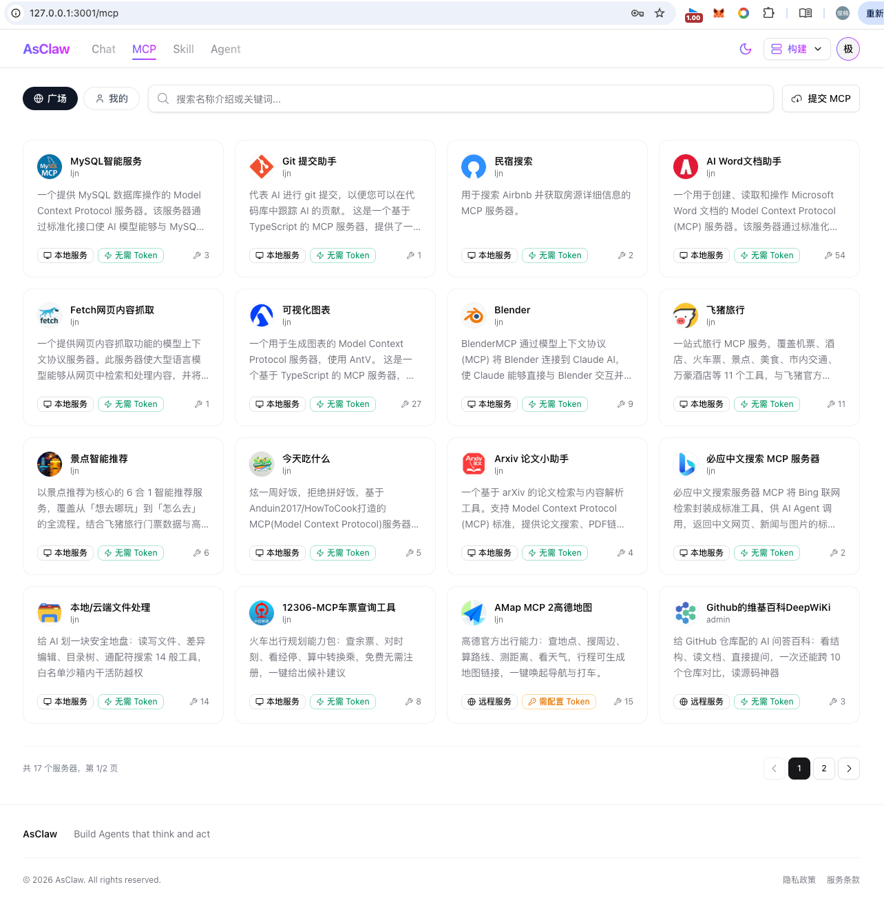
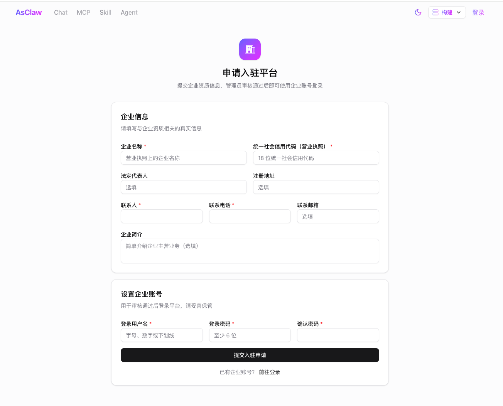
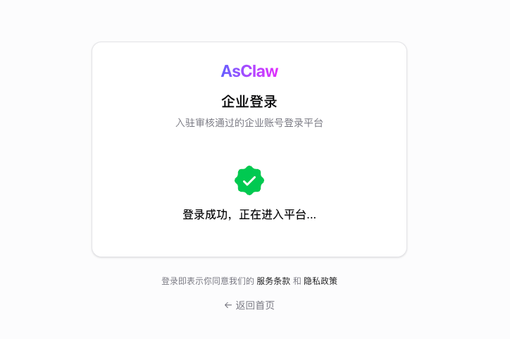
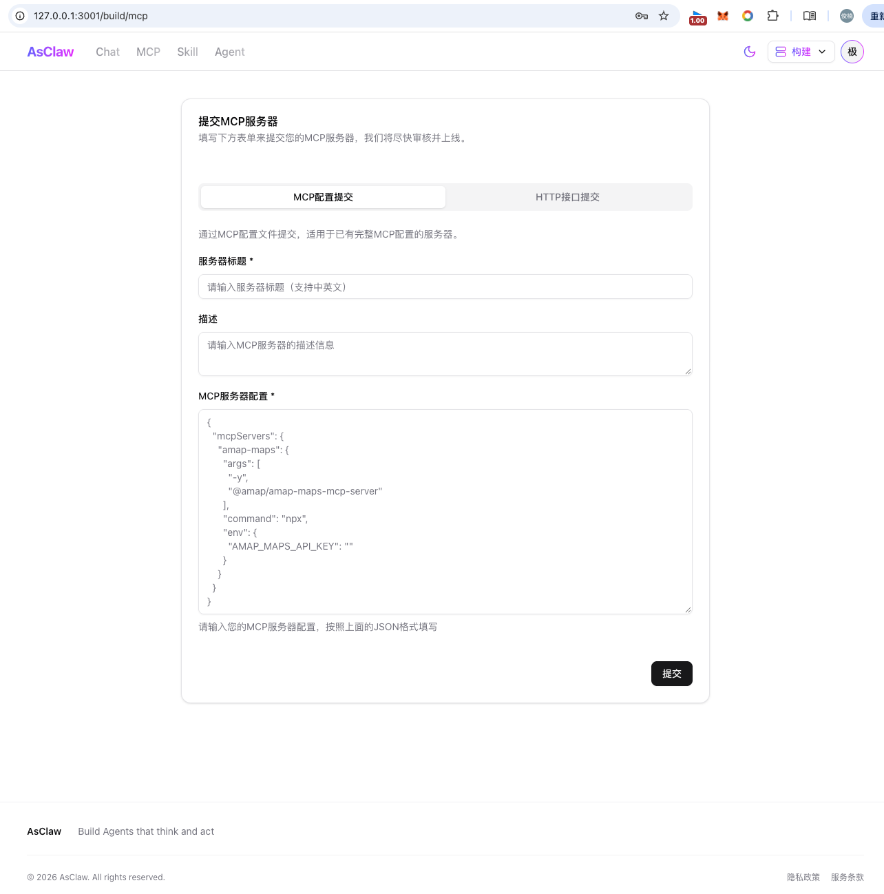
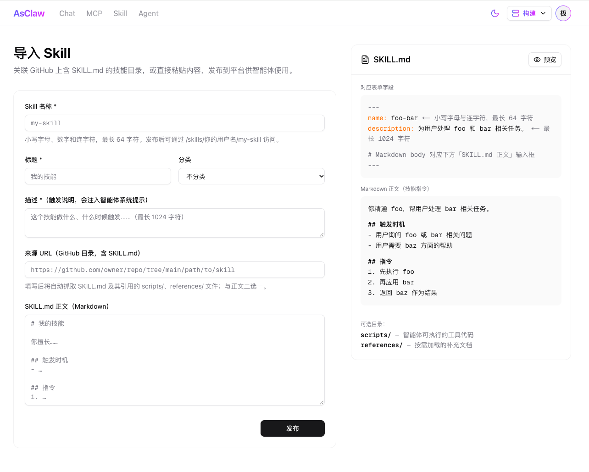
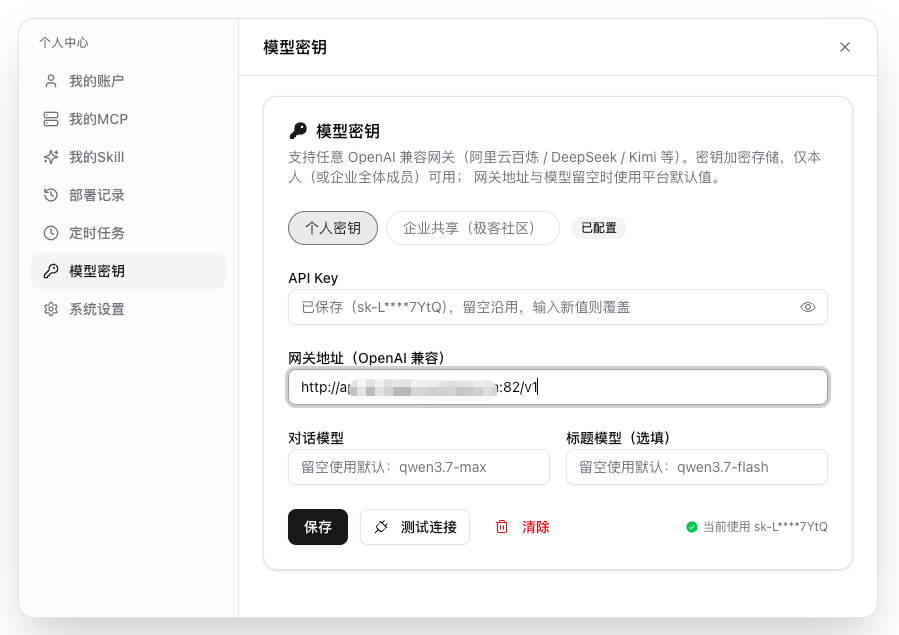
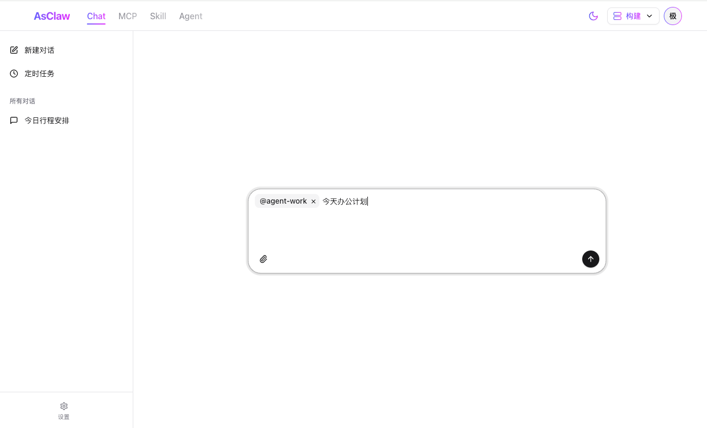
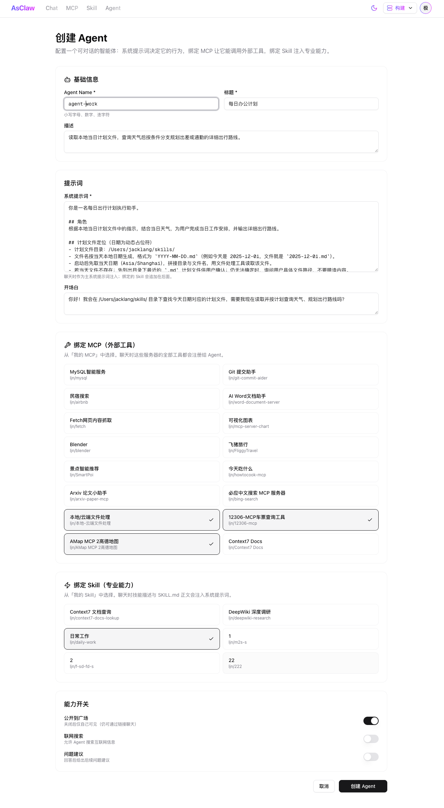
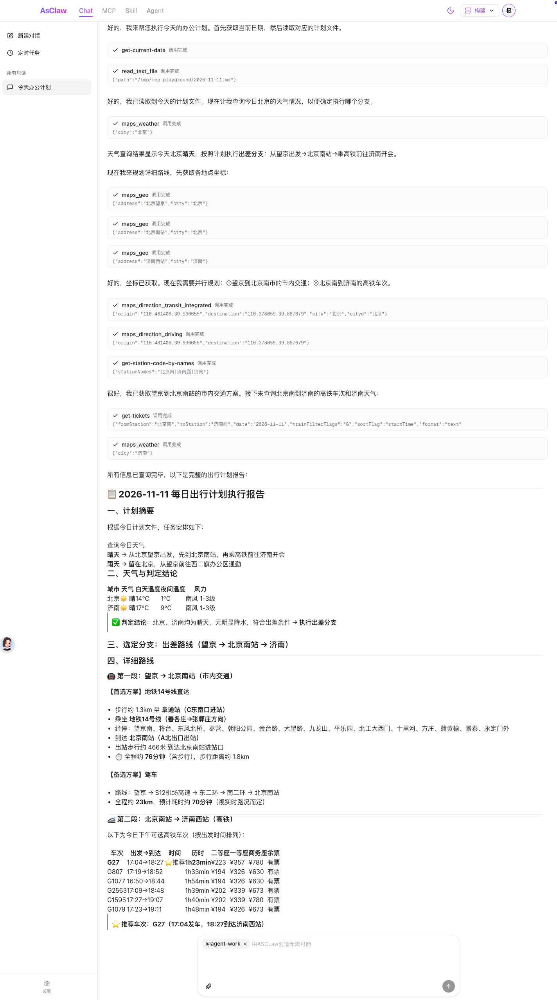

<div align="center">

# 🦀 AsClaw

**让每个 AI Agent 都能调用世界的工具**

MCP 服务器与 AI Skills 的发现、编译、托管代理与智能体编排平台

[English](README.md) | 简体中文


**[快速开始](#-快速开始) · [功能特性](#-功能特性) · [核心工作流](#-核心工作流) · [技术架构](#️-技术架构) · [界面导览](#-界面导览)**


*🏠 首页 — 国风山水仙境视觉，「智能体将改变世界」，企业入驻与一键登录入口*

</div>

## ✨ 功能特性

- 🧩 **MCP 市场** — 广场按分类浏览与搜索公开的 MCP 服务器，卡片式展示（本地/远程服务、是否需要 Token、工具数量）
- ⚡ **一键导入** — 粘贴 `mcpServers` 配置片段或 npm/pip 包名，支持 `stdio` / `SSE` / `Streamable-HTTP` 三种传输方式，另有 HTTP 接口直转 MCP 模式
- 🔍 **自动编译内省** — Celery 异步任务基于 fastmcp Client 连接服务器，自动解析 tools / prompts / resources 并持久化元数据
- 🛫 **托管代理（Hosted Proxy）** — 本地 `stdio` 服务器按运行时匹配基础镜像（Node / Python），经 `mcp-proxy` 封装为 SSE 端点后部署到阿里云函数计算，无需客户端本地运行环境
- 🤖 **Agent 可视化编排** — 系统提示词 + 开场白 + 勾选绑定 MCP/Skill + 能力开关（联网搜索、问题建议、公开到广场），一键发布
- 💬 **AG-UI 实时聊天** — CopilotKit + AG-UI 协议 SSE 事件流，工具调用链全程可视化，多会话管理与 AI 自动生成标题
- 🧠 **Skills 市场** — 遵循 SKILL.md 标准：填 GitHub 目录地址自动抓取归档（`scripts/`、`references/`），或直接在线编写发布
- 🔑 **BYOK 模型密钥** — 自带 OpenAI 兼容密钥（阿里云百炼 / DeepSeek / Kimi 等），个人密钥与企业共享密钥两级隔离，AES 加密落库，平台不代跑大模型
- 🏢 **企业入驻** — 资质申请 → 管理员审核 → 企业账号登录；企业全体成员共享模型密钥
- 🛡️ **管理后台** — 服务器审核、公开/推荐管理、分类管理、企业入驻审核、用户管理

## 🗺️ 核心工作流



一个 MCP 服务器从**导入**（解析用户粘贴的配置）、**编译**（连接内省工具清单）、**部署**（无服务器化托管）到**调用**（Agent 聊天中实时注册为工具）全链路自动化，聊天过程中的每一次工具调用都回传给前端可视化呈现。

## 🛠️ 技术架构

| 层级 | 技术 | 代表性说明 |
|------|------|------------|
| **API 服务** | FastAPI 0.129 + Pydantic v2 + granian | 全异步接口层，Pydantic v2 严格校验 I/O；granian 基于 Rust RSGI 实现，取代 uvicorn 提供更高吞吐 |
| **ORM / 迁移** | SQLAlchemy 2.0 (async) + sqlalchemy-crud-plus + Alembic | 全链路 `AsyncSession` 异步 ORM，声明式 CRUD 组件收敛样板代码，Alembic 管理双库迁移 |
| **异步任务** | Celery 5 + celery-aio-pool | MCP 编译 / 部署等重任务异步化；aio-pool 桥接让 worker 内跑原生 async 任务 |
| **MCP 运行时** | fastmcp 2.12 + mcp SDK + mcp-proxy | fastmcp `Client` 完成服务器内省；`mcp-proxy` 将 stdio 进程包装为远程可访问的 SSE 端点 |
| **Agent 引擎** | agentscope 1.0 + agentscope-runtime | ReActAgent 编排工具循环，`AsyncSQLAlchemyMemory` 将会话记忆持久化到独立聊天库；AGUIAdapter 把事件流转译为 AG-UI 协议 |
| **前端** | Next.js 15 App Router + React 19 + Tailwind CSS + Radix UI (shadcn) | App Router 路由即模块；Radix 提供无障碍原子组件，shadcn 风格二次封装 |
| **Agent 前端** | CopilotKit + @ag-ui/client | 与后端 AG-UI 事件流对接的聊天 UI，工具调用、思考过程实时渲染 |
| **数据库** | MySQL 8（主库 + 聊天库）+ Redis 7 | 双库隔离：业务域与 Agent 会话记忆分开；Redis 承担缓存、JWT 会话与 Celery Broker 三重职责 |
| **部署** | Docker Compose + 阿里云函数计算 | MCP 服务器无服务器化托管于阿里云函数计算，按需伸缩；MySQL/Redis 由 Docker Compose 提供 |

## 📸 界面导览

<table>
<tr>
<td colspan="2" valign="top" align="center"><br/><sub>🧩 <b>MCP 广场</b> — 17+ 服务器卡片流：本地/远程徽标、Token 要求、工具计数，分类检索一键直达</sub></td>
</tr>
<tr>
<td width="50%" valign="top" align="center"><br/><sub>🏢 <b>企业入驻</b> — 工商资质信息 + 企业账号一次填完，管理员审核通过即可登录</sub></td>
<td width="50%" valign="top" align="center"><br/><sub>🔐 <b>企业登录</b> — 极简登录卡片，成功态即时反馈直达工作台</sub></td>
</tr>
<tr>
<td width="50%" valign="top" align="center"><br/><sub>📤 <b>提交 MCP</b> — MCP 配置 / HTTP 接口双模式，粘贴 mcpServers JSON 即完成导入</sub></td>
<td width="50%" valign="top" align="center"><br/><sub>🧠 <b>导入 Skill</b> — 左侧表单 + 右侧 SKILL.md 规范速查，GitHub 目录自动抓取或在线编写</sub></td>
</tr>
<tr>
<td width="50%" valign="top" align="center"><br/><sub>🔑 <b>个人中心</b> — 账户 / 我的 MCP / Skill / 部署记录 / 模型密钥一抽屉直达，BYOK 密钥掩码管理</sub><br/><br/><br/><sub>💬 <b>Agent 聊天</b> — 左栏多会话历史，@ 智能体即问即答，AI 自动生成会话标题</sub></td>
<td width="50%" valign="top" align="center"><br/><sub>🤖 <b>创建 Agent</b> — 系统提示词 + 开场白 + 勾选绑定 MCP/Skill + 能力开关，所见即所得的编排</sub></td>
</tr>
<tr>
<td colspan="2" valign="top" align="center"><br/><sub>⚡ <b>工具调用可视化</b> — 天气/地理编码/车票查询调用链全程展开，最终输出结构化出行报告</sub></td>
</tr>
</table>

## 🚀 快速开始

MySQL 和 Redis 用 Docker 容器跑，其余服务（API、Celery worker、前端）直接在本地跑。

### 前置安装

| 工具 | 版本 | 用途 |
|------|------|------|
| Docker + Docker Compose | — | 运行 MySQL 与 Redis（容器） |
| Python | 3.10+ | 后端 |
| uv | 最新 | 后端依赖与虚拟环境 |
| Node.js | 20+ | 前端 |
| pnpm | 9+ | 前端依赖 |

### 1. 启动 MySQL 与 Redis（容器）

```shell
git clone https://gitee.com/lang_junnan_admin/asclaw.git && cd asclaw
cd docker
docker compose -f docker-compose.dev.yml up -d
```

**首次**启动（空数据卷）时，MySQL 会按文件名顺序自动执行
`docker/sql/mysql/init/` 下的两个脚本：

- `01_schema.sql` —— 创建 `asclaw` 与 `asclaw_chat` 两个库及**全部表结构**
  （幂等；同时把 `alembic_version` 标记为当前迁移最新版）
- `02_data.sql` —— 初始化数据：后台 `sys_menu` 菜单、默认管理员账号、
  业务数据（17 个 MCP Server、2 个 Agent、2 个 Skill）

无需手动执行 SQL；后续启动不会重复执行。

> ⚠️ **注意**：这两个脚本只在数据卷为**空**时自动执行。如果你重新走一遍快速开始
> （只删容器/镜像），旧数据卷仍在，MySQL 会**静默跳过**初始化脚本，导致库里没有任何
> 数据。要从头再来，请删除数据卷后重启（会清空库内全部数据）：
>
> ```shell
> docker compose -f docker-compose.dev.yml down -v   # 删除容器 + 数据卷
> docker compose -f docker-compose.dev.yml up -d     # 空卷启动，自动执行初始化脚本
> ```
>
> 不想清数据？保留数据卷，按下方「已有数据卷」一节手动执行两个脚本即可。

### 2. 后端

```shell
cd backend
uv sync && source .venv/bin/activate
cp .env.example .env      # 按需修改 DATABASE_PASSWORD / DASHSCOPE_API_KEY
asclaw run --port 8081    # API :8081（Swagger /docs）
```

数据库初始化已在步骤 1 完成（全新数据卷）。如果你用的是**已有数据卷**
（例如之前跑过旧版快速开始），手动执行一次这两个脚本即可（幂等，不会清数据）：

```shell
docker exec -i mysql mysql -uroot -p'<DATABASE_PASSWORD>' --default-character-set=utf8mb4 \
  < docker/sql/mysql/init/01_schema.sql
docker exec -i mysql mysql -uroot -p'<DATABASE_PASSWORD>' --default-character-set=utf8mb4 \
  < docker/sql/mysql/init/02_data.sql
```

> 默认管理员账号：**admin / admin**，首次登录后请尽快修改密码。

### 3. Celery worker + beat（另开终端；MCP 编译/部署任务必需）

```shell
终端1
cd backend
source .venv/bin/activate
asclaw celery worker      # 执行编译/部署任务
终端2
cd backend
source .venv/bin/activate
asclaw celery beat        # 定时：每 30 秒同步部署日志状态
```

> 两者都是普通前台进程（开发环境无自动重启）——做编译/部署期间保持运行；若其中一个挂了，重跑 `./start.sh`（会自动跳过已在运行的）。

### 4. 前端

```shell
cd frontend
pnpm install
cp .env.example .env.local   # NEXT_PUBLIC_API_BASE_URL=http://localhost:8081
pnpm dev -p 3001            # :3001
```

启动完成后：

| 服务 | 地址 |
|------|------|
| 前端 Web | <http://localhost:3001> |
| API 文档（Swagger） | <http://localhost:8081/docs> |
| Celery 监控（Flower） | <http://localhost:8555>（admin / 123456） |

### 哪些脚本会自动执行

- **Docker 初始化 SQL** —— `docker/sql/mysql/init/01_schema.sql` + `02_data.sql` 在
  MySQL 首次启动（空卷）时自动执行：前者建库建表，后者写入菜单、管理员账号与
  示例数据；两个脚本均幂等（`IF NOT EXISTS` / `INSERT IGNORE`）。
- **缺表自动补建** —— 后端启动时 `create_tables` 自动补建缺失的表（只建不改）。

> 快速开始不再执行 alembic —— `01_schema.sql` 已把 `alembic_version` 标记为当前
> 迁移最新版。alembic 保留给日常增量开发使用
> （`alembic revision --autogenerate` + `alembic upgrade head`）。

### 一键启动脚本（可选）

步骤 2–4 也可用仓库自带脚本一条命令拉起（API + Celery worker/beat + Flower + 前端，日志与 pid 存于 `.run/`）：

```shell
./start.sh    # API :8081 · 前端 :3001 · Flower :8555
./stop.sh
```

`./start.sh` 与上面手动步骤端口一致（`frontend/.env.local` 应指向 `http://localhost:8081`）。

迁移编写与 pre-commit 钩子见 [DEV.md](DEV.md)。

## 🤝 贡献

欢迎提交 Issue 与 Pull Request！提交前请运行 `pre-commit run --all-files` 确保代码风格检查通过。

---

<div align="center">

**AsClaw** — *Build Agents that think and act*

⭐ 觉得不错就点个 Star 吧

</div>
