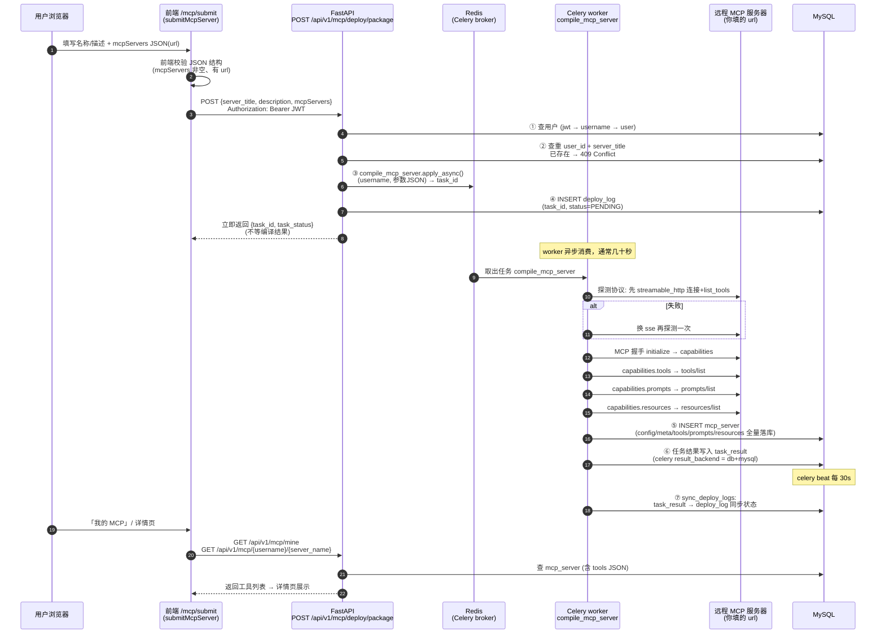
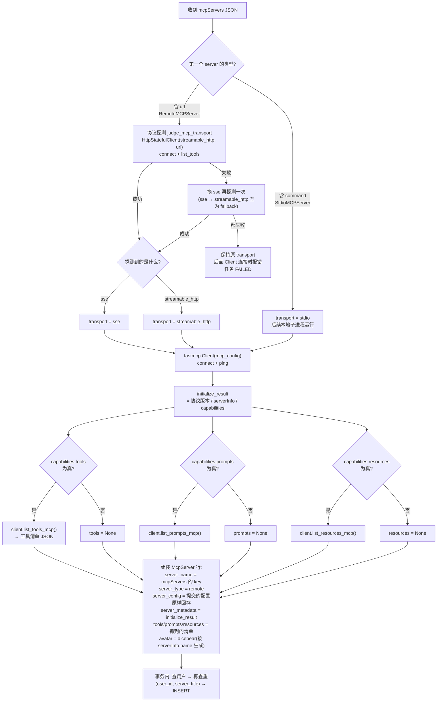
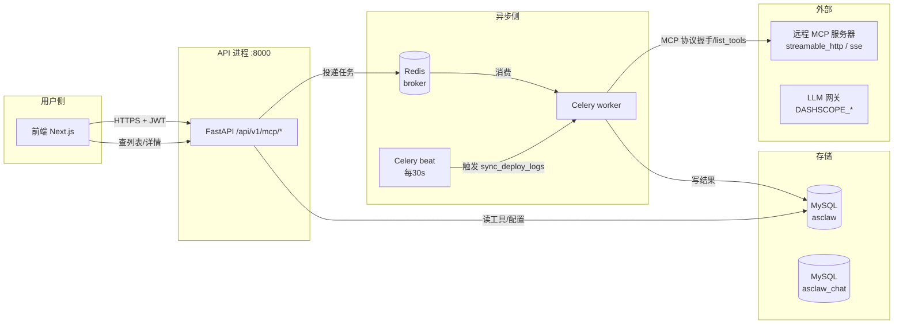

# HTTP（Remote）MCP 提交后的后台流程

> 回答两个问题：
> 1. 前端提交一个 **http 接口（remote）类型的 MCP** 后，后台都做了哪些事、各组件之间怎么交互？
> 2. 提交完成后详情页里出现的**一堆工具（tools）是从哪来的**？

先给一句话结论，再看流程图：

- **后台做了什么**：前端只负责校验 JSON → 后端接口做"查重 + 派发 Celery 任务 + 写部署日志"三件事就立即返回；真正的编译在 Celery worker 里进行 —— 用 MCP 协议**真实连上你填的那个远程 URL**，完成握手（initialize），探测传输协议（streamable_http / sse 二选一），然后把服务器自己上报的 tools / prompts / resources 全部抓下来存进 `mcp_server` 表。
- **工具从哪来**：**全部来自你提交的那个远程 MCP 服务器本身**，平台不做任何工具的生成或拆分。MCP 协议握手时服务器会声明自己的能力（capabilities），平台据此调用 `tools/list`、`prompts/list`、`resources/list` 把清单拉回来，原样存成 JSON。所以一个聚合型 MCP（比如 internally 挂了几十个 API 的网关）提交后就会看到几十个工具。

---

## 一、整体交互流程图



---

## 二、编译任务内部：工具是怎么被"发现"的



关键代码位置：

| 步骤 | 文件 | 说明 |
| --- | --- | --- |
| 提交入口（前端） | `frontend/app/mcp/submit/page.tsx`、`frontend/lib/mcp.ts` | `submitMcpServer()` → POST `/api/v1/mcp/deploy/package` |
| 提交入口（后端） | `backend/app/mcp/api/v1/deploy.py:20` | 查重 → `apply_async` → 写 `deploy_log` → 立即返回 task_id |
| Celery 任务定义 | `backend/app/task/tasks/tasks.py:18` | `compile_mcp_server` → `compile_mcp_service.compile_mcp_by_mcp_config` |
| 编译主体 | `backend/app/task/service/compile_mcp_service.py:52` | 建连、握手、抓清单、落库 |
| 协议探测 | `backend/app/task/service/compile_mcp_service.py:17` | `judge_mcp_transport`：streamable_http 失败自动换 sse |
| 结果回写 | `backend/app/task/celery.py:40` | `result_backend=db+mysql+pymysql` → `task_result` 表 |
| 日志同步 | `backend/app/task/tasks/beat.py` + `tasks.py:23` | `sync_deploy_logs` 每 30s 把 `task_result` 状态同步进 `deploy_log` |
| 工具展示 | `backend/app/mcp/api/v1/mcp.py:82` | `GET /api/v1/mcp/{username}/{server_name}` 返回 tools/prompts/resources |

---

## 三、"很多个工具"具体长什么样

`mcp_server.tools` 列里存的就是 MCP 协议 `tools/list` 的原始返回（JSON 数组），每个元素大致是：

```json
{
  "name": "get_weather",
  "description": "查询城市天气",
  "inputSchema": {
    "type": "object",
    "properties": { "city": { "type": "string" } },
    "required": ["city"]
  }
}
```

- **数量完全由对方服务器决定**：对方声明 `capabilities.tools`，平台才会去拉；对方有 50 个工具，详情页就有 50 个。
- **平台没有做任何转换/拆分/合并**，抓到什么存什么（`compile_mcp_service.py:104` 直接赋值）。
- 列表页的"工具数量"是前端/序列化层对这份 JSON 取 `len()`（`backend/app/mcp/schema/mcp.py:62`）。

---

## 四、各组件交互关系（谁和谁说话）



- **API ↔ Redis**：`apply_async` 把任务丢进 Redis 队列（`app/task/celery.py` 的 `broker_url`），接口立即返回，实现"提交即回"。
- **Worker ↔ 远程 MCP**：编译期是唯一的强交互点 —— 探测协议、握手、拉清单。之后**编译结果只存配置，不存连接**。
- **Agent 聊天 ↔ 远程 MCP**：真正调用工具时（`app/agent/api/v1/thread.py:158` 起），按 `?mcps=owner/name` 从库里读出 `server_config` + `transport`，**重新**建 `HttpStatefulClient`/`StdIOStatefulClient` 连接并注册进 agentscope `Toolkit`，由 ReActAgent 在对话中调用。也就是说：**编译阶段抓的工具清单用于展示和选择，执行阶段每次会话都现场重连**。
- **beat ↔ worker**：beat 只负责每 30 秒触发 `sync_deploy_logs`，把 `task_result`（Celery 结果后端写入）的状态/结果/traceback 搬到 `deploy_log`，前端部署日志页才能看到 SUCCESS/FAILURE。

---

## 五、数据落点

| 表 | 谁写入 | 内容 |
| --- | --- | --- |
| `mcp_server` | Celery worker（编译成功时） | `server_name`（= mcpServers 的 key）、`server_title`（用户填的）、`transport`（探测结果）、`server_type=remote`、`server_config`（提交配置原样回存）、`server_metadata`（initialize 握手结果）、`tools` / `prompts` / `resources`（抓到的清单）、`avatar`（dicebear 随机图） |
| `deploy_log` | API（提交时）+ beat 同步 | `task_id`、`task_status`（PENDING→SUCCESS/FAILURE）、`task_result`、`traceback` |
| `task_result` | Celery result_backend | 任务最终状态与返回值，`sync_deploy_logs` 的数据源 |

唯一约束：`mcp_server` 上是 `(user_id, server_name)`；接口层查重用的是 `(user_id, server_title)` —— 也就是说**同名 title 在接口层被拦，不同 title 但解析出相同 server_name 的提交会在落库时撞唯一约束**（这也是 `compile_mcp_service.py:56` 注释"和 serverInfo.name 不一定一样"相关的坑）。

---

## 六、几个容易疑惑的点

1. **提交接口为什么叫 `deploy/package`？** 历史命名：这个入口同时服务 stdio（本地包）和 remote（http url）两种提交，remote 也走"编译"这个词。对 remote 而言"编译"实际就是"连接并内省"。
2. **提交后多久能看到？** Worker 消费 + 远程握手通常几十秒；`deploy_log` 状态由 beat 每 30 秒同步一次，所以日志页最多有 ~30s 延迟。
3. **为什么我填的是 http，详情页 transport 却是 sse？** `judge_mcp_transport` 先按 streamable_http 探测，连不上自动换 sse，探测成功以谁为准就存谁。
4. **远端改了工具列表怎么办？** 库里存的是**编译那一刻的快照**。目前没有定时重新内省的任务；但 agent 聊天执行时是现场重连，实际可调用的工具以远端当时返回为准，可能与快照不一致。
5. **serverless 部署（`create_serverless`）参与这条链路吗？** 不参与。那是给 stdio 包（npx/uvx）托管到阿里云函数计算用的（`mcp_server_service.compile_command` 用 `mcp-proxy` 把 stdio 包成 SSE），当前仓库里没有 API 入口调用它，属于预留的"hosted 部署"路径。
6. **失败会怎样？** 协议探测两次都失败时探测函数返回原值，随后 `Client(mcp_config)` 建连抛异常 → Celery 任务 FAILURE → `task_result`/`deploy_log` 记录 traceback，`mcp_server` 表不会有记录。
